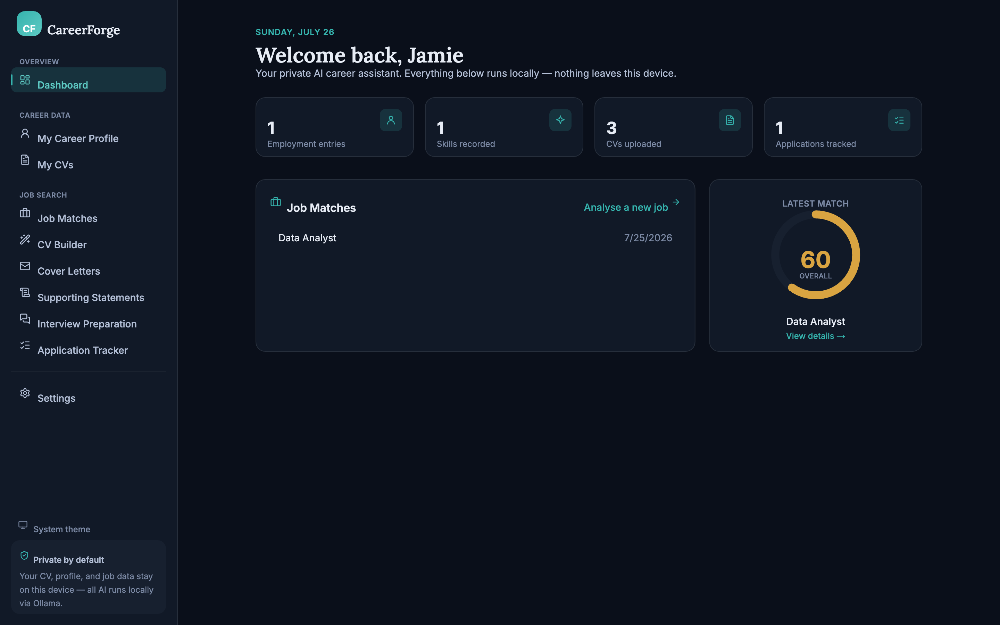
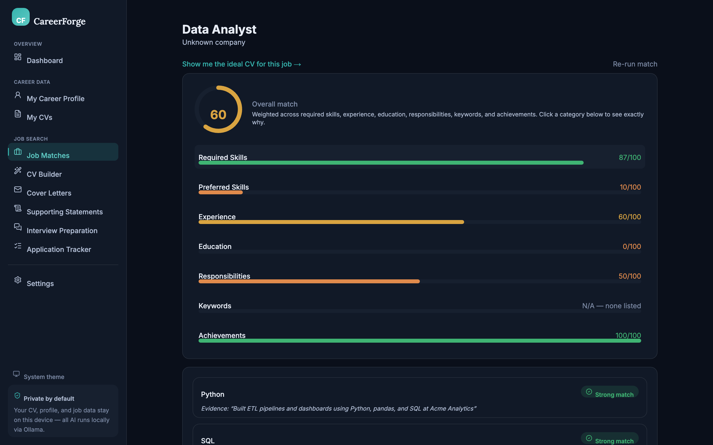
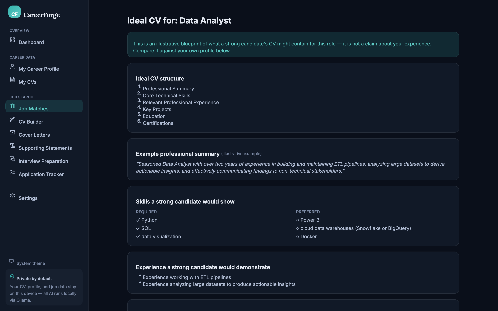
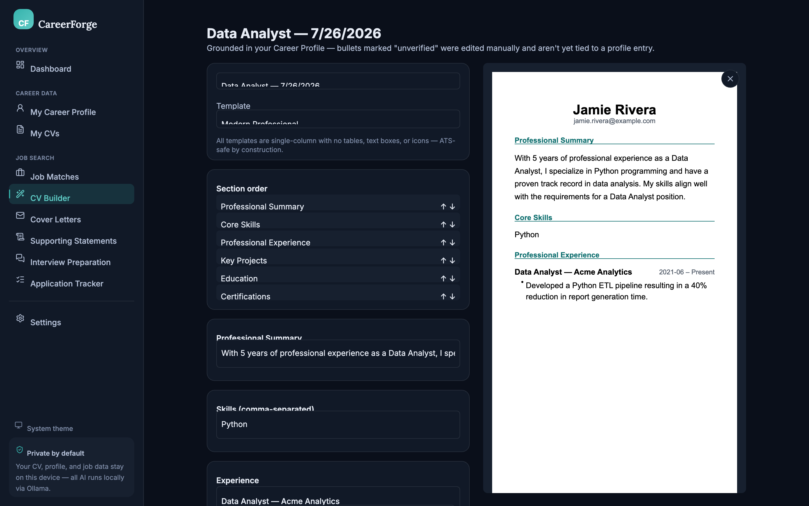

<div align="center">

# 🧭 CareerForge

### A private, local-first AI career intelligence platform.

**CV analysis. Job matching. Tailored generation. Interview prep. 100% on your machine — no cloud, no API keys, no subscriptions.**

CareerForge understands your real experience, compares it against what a job actually requires, shows you exactly where the gaps are, and helps you close them — truthfully. Every AI call runs locally through [Ollama](https://ollama.com). Your CV, career history, and job search never leave your device.

[](#tech-stack)
[](#tech-stack)
[](https://ollama.com)
[](#-privacy--truthfulness)
[](LICENSE)

**⭐ If this is useful, star the repo.**

</div>

---

## 🧠 Why CareerForge?

Most "AI CV tools" are a chatbot with a prompt template — they'll happily invent a metric you never measured or a skill you never used. CareerForge is built the opposite way: **the model is never the source of truth, your verified Career Profile is.**

- **🔒 Totally private** — every extraction, match, and generation call runs against a local model via Ollama. No accounts, no telemetry, no cloud fallback.
- **🧾 Evidence, not vibes** — every match, every generated bullet, every claim traces back to a specific entry in your Career Profile. Nothing is ever invented.
- **⚖️ Honest about gaps** — "not found in your profile" is never phrased as "you don't have this skill." Missing evidence and a missing skill are treated as different things, always.
- **🧩 A real pipeline, not one big prompt** — keyword matching, embeddings, and rule-based ATS checks do the deterministic work; the LLM only classifies and writes prose. Scores are computed in code, never invented by the model.
- **🔁 Nothing blocks on a page** — every AI generation (CV, match, blueprint, cover letter, interview prep) runs as a background job. Switch tabs, navigate away, come back — it's still going, or already done.
- **🆓 Free & source-available** — free for any **noncommercial** use.

---

## 📸 Screenshots

<div align="center">

**Dashboard** — your profile, your latest match, at a glance


**Job Match** — a transparent score with an evidence citation for every item


</div>

| Ideal CV Blueprint | CV Builder |
|:---:|:---:|
|  |  |

---

## ✨ What it can do

<table>
<tr>
<td width="50%" valign="top">

### 📋 Career Profile
- Structured, evidence-backed record of employment, skills, education, projects, certifications
- The single source of truth for matching — not a CV file
- Import from an uploaded CV, with every suggested field reviewed and approved before it's trusted

### 🔍 CV Analysis
- ATS compatibility score with plain-English explanations
- Detects tables, text boxes, images, and other structural risks that break parsers
- Writing-quality and structure feedback

### 🎯 Job Matching
- Paste, upload, or screenshot a job description
- Hybrid engine: keyword match → embedding shortlist → LLM classification → deterministic scoring
- Every requirement labeled Strong / Partial / Underdeveloped / Missing / Unknown, with a citation

### 🗺️ Ideal CV Blueprint
- An illustrative blueprint of what a strong candidate's CV would contain for *this* role
- Clearly labeled as an example, never a claim about you
- Side-by-side gap analysis against your real profile

</td>
<td width="50%" valign="top">

### 🛠️ CV Builder
- Three generation modes: improve an existing CV, tailor to a job, or build from your profile
- Six ATS-safe templates, single-column by construction
- Live preview, section reordering, PDF and DOCX export

### ✉️ Cover Letters & Supporting Statements
- Drafted from your verified profile with length/tone/STAR controls
- Always flagged as an AI draft — review before sending

### 🎤 Interview Preparation
- Likely questions generated from the job's real requirements
- STAR answer drafting grounded in your actual experience
- Mock interview mode with AI feedback on relevance, clarity, structure, and evidence

### 📊 Application Tracker
- Company, role, status, CV version used, cover letter used — all in one place

### ⚙️ Background Jobs
- Every AI generation runs server-side, independent of any open page
- A sidebar indicator shows anything still in progress, from anywhere in the app

</td>
</tr>
</table>

---

## 🚀 Quick Start

```bash
# 1. Install Ollama and pull the models CareerForge uses by default
ollama pull qwen2.5:14b        # reasoning — extraction, matching, generation
ollama pull nomic-embed-text   # embeddings — semantic matching
ollama pull granite3.2-vision  # vision — scanned CV OCR (optional)

# 2. Clone and install
git clone https://github.com/Salahasfan02/careerforge.git
cd careerforge
npm install

# 3. Run it
npm run dev
```

Open **http://localhost:3400**. All three models are swappable any time from **Settings** — CareerForge queries Ollama for whatever you actually have installed.

---

## 📋 Requirements

| | |
|---|---|
| **[Ollama](https://ollama.com)** | running locally, with at least a reasoning model and an embedding model pulled |
| **Node.js** | 18+ |
| **RAM** | 16 GB minimum for a 14B reasoning model; more headroom for larger models |

> 💡 Every model is configurable in Settings — swap `qwen2.5:14b` for anything you have pulled, no code changes required.

---

## 🔐 Privacy & Truthfulness

CareerForge's whole design is built around two non-negotiable rules:

- **Nothing leaves your device.** No cloud AI provider is wired in — every call goes to your local Ollama endpoint. Your data is plain JSON files on disk (`data/`), inspectable, backupable, deletable, entirely under your control.
- **The model never invents.** Every generated CV bullet, cover letter claim, and match citation is traceable to a real entry in your Career Profile. When something can't be verified, the app says so explicitly — a missing requirement is reported as "not found in your profile," never as "you don't have this."

---

## 🏗️ Tech Stack

**Framework:** Next.js 15 (App Router) · TypeScript · Tailwind v4
**AI:** Ollama (reasoning + embeddings + vision), all configurable per-provider
**Storage:** Flat JSON files — no database server, fully inspectable, fully local
**Documents:** `@react-pdf/renderer` (PDF) · `docx` (DOCX) · `mammoth` / `pdf-parse` (parsing)

Modular by design — the AI provider, embedding model, document parser, and storage layer can each be swapped independently. See [`lib/`](lib) for the pipeline stages: `lib/ai` (provider + structured output), `lib/parsing` (document extraction), `lib/pipeline` (matching, generation, ATS analysis), `lib/server` (the JSON data layer + background job runner).

---

## 🗺️ Roadmap

- [ ] "Paste a job listing URL" — fetch and parse a job posting directly from a link
- [ ] Field-level encryption at rest for the local data store
- [ ] Full OCR pipeline for scanned PDFs with no text layer (currently: re-upload as an image)
- [ ] Voice input for the mock interview mode

## 🤝 Contributing

PRs, ideas, and bug reports are welcome — CareerForge is designed to be extended. The pipeline is modular: a new document parser, a new AI provider, or a new CV template each drop in without touching the rest of the app.

## ⭐ Star it

If CareerForge is useful, **drop a star** — it helps other people find it.

## 📄 License

[PolyForm Noncommercial 1.0.0](LICENSE) — **free for any noncommercial use**: personal projects, hobby, research, education, and nonprofits. Use, modify, and share it freely — just not for commercial resale. Commercial use requires a separate license from the author.
